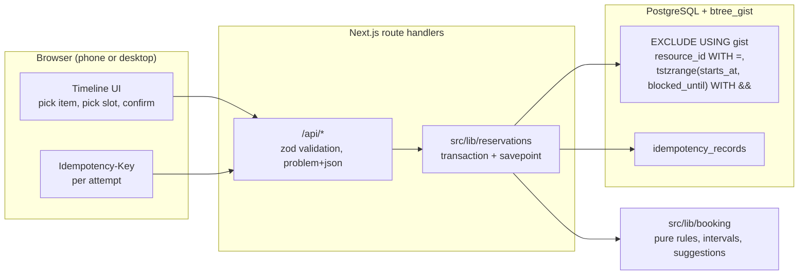

# loan-loop

loan-loop lets staff and students of a university media lab reserve one specific piece of shared
equipment (cameras, lenses, audio recorders, 3D printers) for a time block, and answers with either
a confirmed, conflict-free booking or an immediate, explicit rejection. It is built for phones on
flaky campus Wi-Fi and for the rush when a new week of slots opens.

<!-- screenshots: added in the docs pass -->

> **Status:** under construction. Commands below are added commit by commit; see the git history
> and [ROADMAP.md](ROADMAP.md).

## Architecture



Two rules hold throughout:

1. **The database is the only judge of overlap.** The application validates input and suggests
   alternatives, but whether a booking exists is decided by the exclusion constraint. A violation
   (`23P01`) becomes `409`, never `500`.
2. **Every write is idempotent.** Create and cancel carry a client-generated `Idempotency-Key`; a
   retry replays the stored outcome instead of repeating the effect.

## Built with

Next.js (App Router, Turbopack, Cache Components, typed routes) · React · TypeScript (strictest
flags) · Tailwind CSS v4 · zod · Drizzle ORM + `pg` · PostgreSQL with `btree_gist` · PGlite for
local development · Biome · Vitest + fast-check + Testcontainers · pnpm with supply-chain
hardening.

## Setup

Requirements: Node 26.13.0 and pnpm 12.16.1 (both pinned in `package.json` `devEngines`), plus Docker
for the integration tests only.

```sh
pnpm install
cp .env.example .env
pnpm db:server      # terminal 1: local Postgres (PGlite behind a socket), no Docker needed
pnpm db:migrate     # terminal 2
pnpm db:seed        # reference scenario with dummy data
pnpm dev
```

## Checks

```sh
pnpm check              # typecheck + lint + all tests
pnpm test:unit          # pure core and property tests, no database
pnpm test:integration   # real PostgreSQL via Testcontainers (Docker required)
```

Integration tests use `DATABASE_URL_TEST` when set (for example the service container in CI) and
otherwise start a disposable `postgres` container. SQLite, MySQL and PGlite are not accepted
stand-ins for the concurrency tests; see
[ADR 0004](docs/adr/0004-real-postgres-for-concurrency-tests.md).

## Database

PostgreSQL with the `btree_gist` extension is required. Migrations live in `drizzle/` and are applied
by `pnpm db:migrate`. Moving from the local PGlite server to a hosted PostgreSQL changes only
`DATABASE_URL`.

## Using it

- `pnpm db:seed` loads three identical Sony A7 IV bodies, one Prusa MK4 (30 min buffer), lenses and
  audio recorders, plus a few reservations.
- `pnpm scenario` replays the reference scenario in [docs/domain.md](docs/domain.md): 40 concurrent
  requests for "Camera #2, Friday 14:00-18:00". Exactly one wins; the rest get `409` with suggestions.
- `pnpm admin -- <command>` manages resources and categories (no admin UI in v1).
- `pnpm purge` deletes reservation history older than the retention window.

## API

All bodies are JSON. Errors use `application/problem+json` with a stable `code`.
Writes require an `Idempotency-Key` header (a UUID generated per attempt).

| Method | Path | Purpose | Success | Errors |
| ------ | ---- | ------- | ------- | ------ |
| GET | `/api/me` | Current opaque user id and display name | 200 | 401 |
| GET | `/api/resources` | Items with category, location label, buffer | 200 | 401 |
| GET | `/api/resources/{id}/availability?from&to` | Taken blocks (buffer included) in a window | 200 | 404, 422 |
| GET | `/api/reservations` | The caller's active reservations | 200 | 401 |
| POST | `/api/reservations` | Create a booking `{resourceId, startsAt, endsAt}` | 201 | 400, 409 `conflict` / `quota_exceeded`, 422 |
| POST | `/api/reservations/{id}/cancel` | Cancel (status change, no delete) | 200 | 404, 409 `already_cancelled` |

## Documentation

- [AGENTS.md](AGENTS.md): rules for people and agents changing this repository
- [ROADMAP.md](ROADMAP.md): what is built, what is next, estimates
- [docs/domain.md](docs/domain.md): glossary, rules, defaults, reference scenario
- [docs/landscape.md](docs/landscape.md): alternatives and how this differs
- [docs/adr/](docs/adr/): architecture decision records

## Data policy

Only an opaque SSO subject id and a display name are stored for people. No emails, phone numbers,
student numbers or other personal data. Cancelled reservations keep a `cancelled` status instead of
being deleted; history older than 12 months is purged.

## Ownership and license

Maintained by David Espinosa. Released under the [MIT License](LICENSE).
