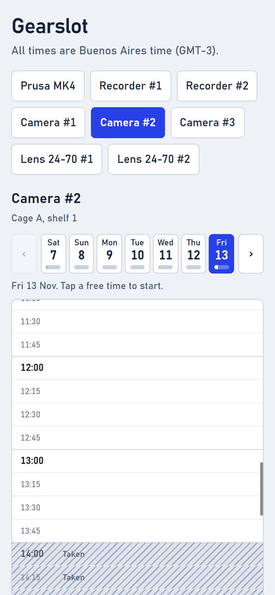
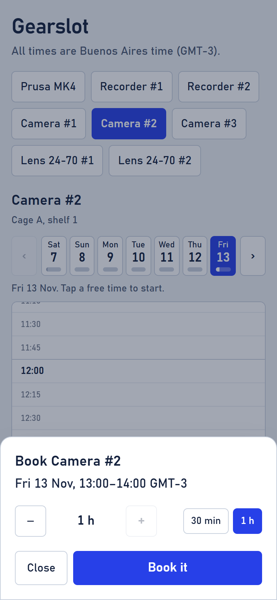
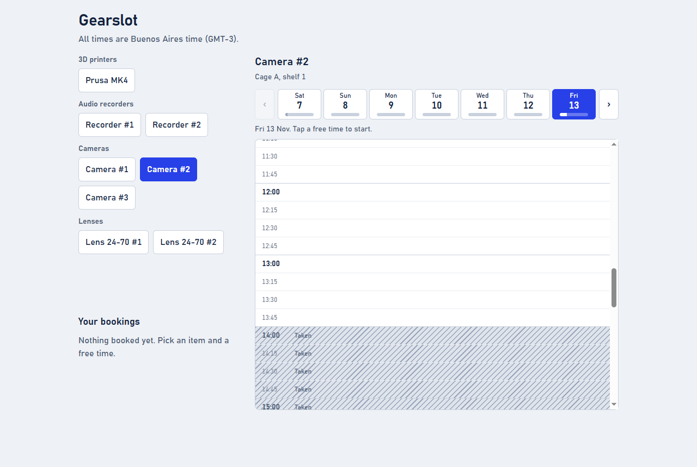
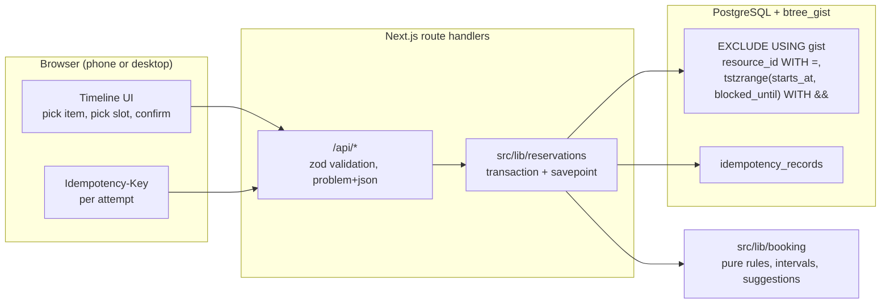

# Gearslot

Gearslot lets staff and students of a university media lab reserve one specific piece of shared
equipment (cameras, lenses, audio recorders, 3D printers) for a time block, and answers with either
a confirmed, conflict-free booking or an immediate, explicit rejection. It is built for phones on
flaky campus Wi-Fi and for the rush when a new week of slots opens.

## Screenshots

Dummy data only (the reference scenario from [docs/domain.md](docs/domain.md)). Taken time is the
hatched block; the timezone is always labelled.

| Phone: pick a free time | Phone: confirm | Desktop |
| ----------------------- | -------------- | ------- |
|  |  |  |

## Architecture



Two rules hold throughout:

1. **The database is the only judge of overlap.** The application validates input and suggests
   alternatives, but whether a booking exists is decided by the exclusion constraint. A violation
   (`23P01`) becomes `409`, never `500`.
2. **Every write is idempotent.** Create and cancel carry a client-generated `Idempotency-Key`; a
   retry replays the stored outcome instead of repeating the effect.

## Built with

Versions are pinned exactly in `package.json`; a release must be 7.5 days old before pnpm installs it.

| Layer | Technology | Version | Role here |
| ----- | ---------- | ------- | --------- |
| Runtime | Node.js | 26.13.0 | Pinned through `devEngines` |
| Package manager | pnpm | 12.16.1 | `minimumReleaseAge` 10800 min, dependency build scripts denied by default |
| Framework | Next.js | 16.4.3 | App Router, Turbopack, Cache Components, typed routes, route handlers for the API |
| UI | React | 19.3.1 | The single booking screen |
| Styling | Tailwind CSS | 4.3.3 | Design tokens in CSS, light and dark |
| Language | TypeScript | 7.0.2 | Strictest compiler flags |
| Validation | zod | 4.6.7 | Request bodies, queries and headers |
| Database | PostgreSQL with `btree_gist` | 18 (tests) | Required. The exclusion constraint is the overlap guarantee |
| Data access | Drizzle ORM, drizzle-kit, `pg` | 0.45.4, 0.31.11, 8.23.1 | Schema, migrations, pooled connections |
| Local database | PGlite and pglite-socket | 0.5.13, 0.2.16 | Postgres in WASM behind a socket, no Docker for development |
| Lint and format | Biome | 2.6.4 | One tool for both |
| Tests | Vitest, fast-check, Testcontainers | 5.0.5, 4.10.2, 12.2.1 | Unit, property and real-PostgreSQL concurrency tests |
| CI | GitHub Actions | pinned to commit SHAs | `pnpm check` and `pnpm build` |

## Setup

Requirements: Node 26.13.0 and pnpm 12.16.1 (both pinned in `package.json` `devEngines`), plus Docker
for the integration tests only. Authentication is the institution's SSO gateway in front of the app
([ADR 0006](docs/adr/0006-identity-comes-from-the-sso-gateway.md)); in development `.env` supplies a
fixed identity.

```sh
pnpm install
cp .env.example .env
pnpm db:server      # terminal 1: local Postgres (PGlite behind a socket), no Docker needed
pnpm db:migrate     # terminal 2
pnpm db:seed        # reference scenario with dummy data
pnpm dev
```

## Checks

```sh
pnpm check              # typecheck + lint + all tests
pnpm test:unit          # pure core and property tests, no database
pnpm test:integration   # real PostgreSQL via Testcontainers (Docker required)
```

The integration suite includes the reference scenario (40 simultaneous requests, exactly one winner),
raw concurrent inserts that bypass the app, idempotent retries, the category cap under parallel
requests, ordered row locks (reschedule and swap), DST (New York and the lab's own zone), and the retention
purge. CI runs the same `pnpm check`.

Integration tests use `DATABASE_URL_TEST` when set (for example the service container in CI) and
otherwise start a disposable `postgres` container. SQLite, MySQL and PGlite are not accepted
stand-ins for the concurrency tests; see
[ADR 0004](docs/adr/0004-real-postgres-for-concurrency-tests.md).

## Database

PostgreSQL with the `btree_gist` extension is required. Migrations live in `drizzle/` and are applied
by `pnpm db:migrate`. Moving from the local PGlite server to a hosted PostgreSQL changes only
`DATABASE_URL`.

## Using it

- `pnpm db:seed` loads three identical Sony A7 IV bodies, one Prusa MK4 (30 min buffer), lenses and
  audio recorders, plus a few reservations.
- `pnpm scenario` replays the reference scenario in [docs/domain.md](docs/domain.md): 40 concurrent
  requests for "Camera #2, Friday 14:00-18:00". Exactly one wins; the rest get `409` with suggestions.
- `pnpm scenario:http` runs the same race over real HTTP against a running server (`pnpm build && pnpm
  start`, `BASE_URL` if not on port 3000). It needs a fresh database and prints why when the slot is
  already taken. Over HTTP on a production build it reports 1 confirmed and 39 conflicts in about
  0.6 s. The fixed Monday 09:00 clock version is `tests/integration/api-race.test.ts`.
- `pnpm admin -- <command>` manages resources and categories (no admin UI in v1).
- `pnpm purge` deletes reservation history older than the retention window.

## API

All bodies are JSON. Errors use `application/problem+json` with a stable `code`.
Writes require an `Idempotency-Key` header (a UUID generated per attempt).

| Method | Path | Purpose | Success | Errors |
| ------ | ---- | ------- | ------- | ------ |
| GET | `/api/me` | Current opaque user id and display name | 200 | 401 |
| GET | `/api/resources` | The lab's rules (timezone, grid, limits) and its items with category, location label, buffer | 200 | 401 |
| GET | `/api/resources/{id}/availability?from&to` | Taken blocks (buffer included) in a window | 200 | 404, 422 |
| GET | `/api/reservations` | The caller's active reservations | 200 | 401 |
| POST | `/api/reservations` | Create a booking `{resourceId, startsAt, endsAt}` | 201 | 400, 409 `conflict` / `quota_exceeded`, 422 |
| POST | `/api/reservations/{id}/reschedule` | Move your booking `{startsAt, endsAt}`; same item, same rules | 200 | 400, 404, 409 `conflict`, 422 |
| POST | `/api/reservations/swap` | Exchange the times of two of your bookings of the same item `{firstId, secondId}` | 200 | 400, 404, 409, 422 |
| POST | `/api/reservations/{id}/cancel` | Cancel (status change, no delete) | 200 | 404, 409 `already_cancelled` |

## Documentation

- [AGENTS.md](AGENTS.md): rules for people and agents changing this repository
- [ROADMAP.md](ROADMAP.md): what is built, what is next, estimates
- [docs/domain.md](docs/domain.md): glossary, rules, defaults, reference scenario
- [docs/landscape.md](docs/landscape.md): alternatives and how this differs
- [docs/adr/](docs/adr/): ten architecture decision records, including the choices not made
  (no Redis lock, no queue, no blockchain)

## Data policy

Only an opaque SSO subject id and a display name are stored for people. No emails, phone numbers,
student numbers or other personal data. Cancelled reservations keep a `cancelled` status instead of
being deleted; history older than 12 months is purged.

## Ownership

This is a 100% independent, personal side project. It is not related to,
sponsored by, or developed for any employer or client.

## License

Released under the MIT License. See [LICENSE](LICENSE).
